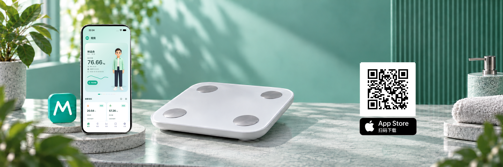

<div align="center">


# 观我

### ScaleMe

[](https://developer.apple.com/ios/)
[](https://www.swift.org/)
[](https://developer.apple.com/xcode/swiftui/)
[](https://www.bluetooth.com/)
[](#数据存储与隐私)

原生 iOS 体重与身体成分趋势应用

**观察身体变化，看见自己的健康轨迹。**

[**简体中文**](README.md) | [繁體中文](Docs/readme/README-zh-Hant.md) | [English](Docs/readme/README-en.md) | [日本語](Docs/readme/README-ja.md) | [Français](Docs/readme/README-fr.md) | [Deutsch](Docs/readme/README-de.md) | [Español](Docs/readme/README-es.md) | [Português](Docs/readme/README-pt.md) | [Русский](Docs/readme/README-ru.md) | [한국어](Docs/readme/README-ko.md)

</div>

观我（ScaleMe）是一款面向个人与家庭的原生 iOS 体重与身体成分记录应用。通过蓝牙连接兼容的体重秤，也可手动录入测量，按成员、设备和时间查看历史记录与变化趋势。

应用无需注册账号，成员资料、设备配置和测量记录保存在设备上，不上传至开发者服务器，也不提供应用自身的云端同步。Apple 健康读写和文件导入导出由用户自行启用或操作。

<div align="center">

<a href="https://apps.apple.com/app/id6808930548">
  
</a>

</div>

## 主要功能

### 测量与记录

- 发现并关联兼容的蓝牙体重秤，显示测量过程及设备提供的可用数据，保存稳定测量结果。
- 手动记录体重，选择测量日期与时间，按需补充设备显示的身体成分数值，支持补录历史记录。
- 查看测量详情、修改记录的成员归属或删除记录；支持的设备协议可读取秤内历史，并进行成员匹配和去重。
- 实时测量先保存到本机文件，再进入正式记录并触发已启用的健康共享；保存失败时显示未保存状态并提供重试入口。

### 家庭成员与趋势

- 建立多个成员档案，管理多台设备，分别查看各成员的记录。
- 在首页选择和排列健康指标，查看最新值、指标含义和适用的参考范围。
- 按成员、设备、时间范围和指标筛选趋势，结合图表与历史记录观察变化。
- 提供小、中、大三种尺寸的桌面趋势小组件；每个小组件可独立选择指标、时间范围、设备、成员及显示方式。

### 数据管理与 Apple 健康

- 通过 JSON 文件分别或同时导入导出配置与测量记录，提供本机数据删除功能。
- 可选读取 Apple 健康中的体重、体脂率并导入“本人”档案，也可将符合条件的新测量写入 Apple 健康。
- 健康同步开关与系统授权分别管理；关闭同步后仍可使用蓝牙测量、手动记录与趋势查看。

### 界面与辅助功能

- 支持简体中文、繁体中文、英语、日语、法语、德语、西班牙语、葡萄牙语、俄语和韩语，可跟随系统或在应用内选择。
- 提供默认与色觉友好主题，支持浅色、深色及跟随系统外观。
- 为测量状态、图表、菜单与表单提供 VoiceOver 支持，并适配动态字体和减少动态效果设置。实际验收范围见[无障碍验证](Docs/Accessibility.md)。
- 提供家庭模拟数据，方便在没有体重秤时体验界面；模拟模式内的记录修改不写入正式测量数据，下次启动恢复预设数据。

## 设备兼容性

项目已实现 Bluetooth SIG 标准体重与身体成分特征解析，以及多个厂商协议的广播解析或 GATT 测量会话。不同协议的功能与验证程度不同，不能按品牌名称推断所有型号均可使用。

- 扫描到设备、匹配名称或登记协议，不等于已经支持测量。
- 数据样本测试验证解析行为，不等于完成 iPhone 与真实体重秤的端到端验证。
- 实时测量、身体成分、设备历史读取和认证配置均取决于具体协议；未确认的数据字段不会作为已知指标保存。
- 可从本地 JSON 文件导入符合格式的声明式通信规则；应用不从远程地址下载协议。

具体协议、当前能力、验证层级与研究来源见[体重秤协议支持矩阵](Docs/BluetoothProtocolSupport.md)，扩展格式见[外部通信规则](Docs/ExternalCommunicationRules.md)。

## 指标与估算说明

应用区分设备原始值与应用计算值。体重、设备提供的身体成分、根据成员资料计算的 BMI，以及满足条件时补算的身体成分，各有不同的数据来源和适用范围。

对于已识别的体脂设备，优先使用设备或协议提供的指标；仅在具备有效主阻抗、成员资料且符合模型条件时，对缺失的身体成分进行实验性估算。普通体重秤、手动记录及 Apple 健康导入不触发这类默认补算。缺少主阻抗时，不以 BMI 替代阻抗来估算缺失的身体成分。

计算结果随测量记录保存，设备原始值与应用估算分开存储；修改成员资料不会自动重算历史记录，重新分配记录成员时会重新计算。应用估算不写入 Apple 健康。模型的年龄范围、设备适配假设和经验规则存在限制，不能将应用估算视为厂商官方算法或临床测量。

应用内“数据说明”和各指标计算页提供公式、来源与适用范围，技术细节见[数据、同步与隐私](Docs/DataAndPrivacy.md)。身体成分结果仅供观察趋势，不用于诊断、治疗或医疗决策。

## 数据存储与隐私

### 本机存储

成员资料、设备配置与测量记录以版本化 JSON 文件保存在应用沙盒中，配置和记录分开存储，使用 iOS Complete File Protection。设备绑定与认证秘密保存在系统 Keychain 中。

桌面小组件通过本机 App Group 读取精简的趋势快照；快照使用 AES-GCM 加密，密钥通过共享 Keychain 管理。这是同一设备上应用与扩展之间的数据共享。

应用不包含账号系统、广告或分析上报服务，不将成员资料和健康测量上传至开发者服务器，也不使用 iCloud 实时同步这些数据。

### 用户控制的数据流转

- **系统备份**：配置与测量文件可包含在用户启用的系统设备备份中，由系统负责备份和恢复。
- **Apple 健康**：读写默认关闭，需要用户设置并授权。读取数据仅导入“本人”；写入仅针对“本人”由所选真实设备产生的新稳定测量。历史导入、手动记录、模拟数据和应用估算不写入 Apple 健康。关闭同步不会删除已写入或已导入的数据。
- **文件导入导出**：由用户主动操作。导出的 JSON 是未加密明文，可能包含成员资料、设备信息和测量记录，保存位置与分享对象由用户选择。
- **诊断导出**：由用户主动采集和导出，可能包含设备标识及测量载荷，不应公开分享原始文件。

完整说明见[隐私政策](Docs/PrivacyPolicy.md)，健康授权与验证流程见[HealthKit 验证指南](Docs/AppReviewHealthKit.md)。

## 技术与项目结构

最低支持 iOS 17，使用 Swift、SwiftUI、Charts、CoreBluetooth、HealthKit、WidgetKit 与 CryptoKit。界面、领域计算、协议解析和系统服务按职责分层。

```text
ScaleMe/
├── App/              # 应用入口、导航、启动流程与全局状态
├── Core/             # 本地化等跨功能基础能力
├── Domain/           # 领域模型、计算与趋势分析
├── Infrastructure/   # 蓝牙、持久化、健康数据、诊断与小组件导出
├── Features/         # 首页、测量、趋势、设备和设置
├── Shared/           # 设计系统与共享组件
└── Resources/        # Assets、String Catalog 与配置资源
ScaleMeWidget/        # 桌面趋势小组件
ScaleMeWidgetShared/  # 主应用与小组件共享的数据契约和存储
Docs/                # 实现与验证文档
└── readme/           # 其他语言的 README 全文翻译
Tests/Smoke/         # 协议、领域计算及本地化等确定性检查
Tools/               # 开发与资源生成工具
```

具体分层、状态流转和蓝牙管线见[架构与实现](Docs/Architecture.md)。

## 运行项目

1. 使用 Xcode 26 或更新版本打开 `ScaleMe.xcodeproj`，选择 `ScaleMe` scheme。
2. 在模拟器中运行，从“设置 → 数据管理”开启模拟数据，体验成员、设备、记录与图表。
3. 测试真实蓝牙测量时，配置开发团队并安装到 iPhone，在使用设备搜索时授予蓝牙权限。
4. 测试小组件时，为主应用与 `ScaleMeWidget` 扩展配置匹配的 App Groups 和 Keychain Sharing 能力。

模拟器和自动化测试不能替代蓝牙、HealthKit 与具体秤型的真机验证。环境要求、构建命令与测试入口见[开发与验证](Docs/Development.md)。

## 文档与贡献

- [文档导航](Docs/README.md)
- [架构与实现](Docs/Architecture.md)
- [体重秤协议支持矩阵](Docs/BluetoothProtocolSupport.md)
- [数据、同步与隐私](Docs/DataAndPrivacy.md)
- [开发与验证](Docs/Development.md)
- [Agent 开发约定](AGENTS.md)

中文产品名为“观我”，英文名及 Xcode 工程名为“ScaleMe”。规范标志见 [`Design/Logo/logo.svg`](Design/Logo/logo.svg)。文档中的第三方品牌名称仅用于说明设备兼容性或技术来源，不代表相关厂商背书。

## 许可证

本项目整体源码发行采用 **[GNU GPL v3 或后续版本](LICENSE)**（`GPL-3.0-or-later`）。原创贡献版权归属为 Copyright (C) 2026 bugwz；第三方部分保留其原始版权与许可，详见[项目授权声明](NOTICE)和[许可证与第三方声明](LICENSES/README.md)。
